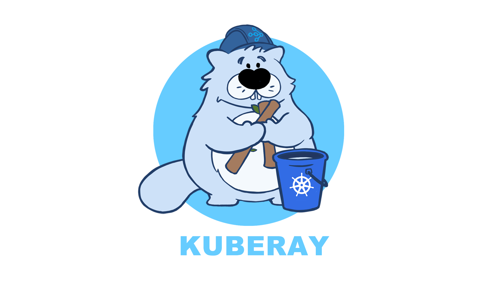

# KubeRay artwork

The five supplied PNGs are preserved without image modification. Each image is 1920 × 1080 pixels.

| Original file | Repository file | Description |
| --- | --- | --- |
| `1.png` | `stacked/color/kuberay-stacked-silhouette.png` | White mascot silhouette with a black circle, blue background, and cyan wordmark |
| `2.png` | `stacked/color/kuberay-stacked-color.png` | Full-color stacked logo on a white background |
| `3.png` | `mockups/kuberay-business-cards.png` | Business card design mockup |
| `4.png` | `mockups/kuberay-tote-bag.png` | Tote bag design mockup |
| `5.png` | `mockups/kuberay-booth.png` | Exhibition booth design mockup |

## Logo preview

## Available formats

These files are the supplied raster artwork and design mockups. Vector SVGs, standalone icons, horizontal logos, and complete black/white variants are not included. The silhouette image retains colored elements and is not a monochrome white logo.
